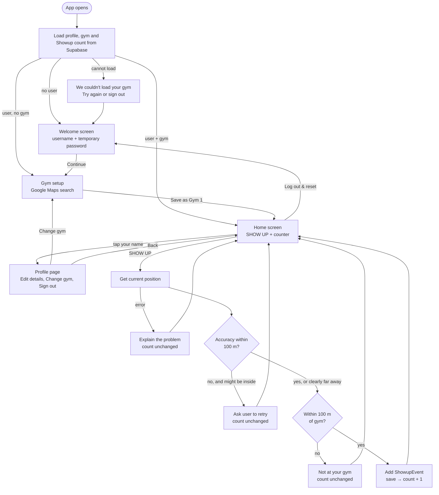
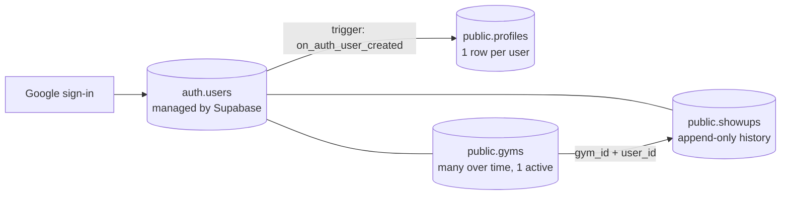

# Architecture

Showup is a **client-side single-page app** (React + Vite) with no server of its own. The browser talks directly to three outside services:

- **Supabase** for Google sign-in and the Postgres database (profiles, gyms, Showups).
- **Google Maps** for gym search.
- **The browser itself** for the device location (Geolocation API).

> **Where data lives.** Everything is in Supabase: sign-in, the `profiles` table, the user's `gyms`, and every `showups` row. The browser stores nothing about gyms or Showups (only the sign-in session). See [DATABASE_SCHEMA.md](DATABASE_SCHEMA.md).

## The big picture

The code is split into layers. Each layer only talks to the one below it.

```
┌──────────────────────────────────────────────┐
│  Screens & components   (src/features, src/components)
│  Show things; call callbacks when clicked.   │
├──────────────────────────────────────────────┤
│  App + useShowup hook   (src/app, src/hooks) │
│  Owns the app state; decides which screen.   │
├──────────────────────────────────────────────┤
│  Services               (src/services)       │
│  Rules, storage, geolocation, Google Maps.   │
├──────────────────────────────────────────────┤
│  Utils, config, types   (src/utils, src/config, src/types)
└──────────────────────────────────────────────┘
```

The rules that decide whether a Showup counts (`attendanceService.ts`) contain no React code. That makes them easy to test and easy to move to a server later.

## Main user flow



## Folders

| Folder | Purpose |
|---|---|
| `src/app/` | `App.tsx` (chooses the screen), `theme.ts` (MUI dark theme), and the storage problem screen. |
| `src/features/` | One folder per feature, each holding its screen(s): `authentication/`, `gym/`, `attendance/`. |
| `src/components/` | Small reusable UI pieces with no business logic: the button, counter, gym card, feedback message and page layout. |
| `src/hooks/` | `useShowup.ts`: the app's state and actions, shared by all screens. |
| `src/features/profile/` | Onboarding screen, Manage Profile screen and the shared `ProfileForm` (name and birthday). |
| `src/services/` | Code that talks to the outside world (Supabase Auth and database, Geolocation, Google Maps) and the attendance rules. |
| `supabase/` | The database: `migrations/` (SQL that defines the tables, trigger and security) and `tests/` (checks that run those migrations on a throw-away Postgres). |
| `src/utils/` | Pure helper functions: distance maths and ID generation. |
| `src/config/` | Settings (`constants.ts`) and user-facing feedback text (`messages.ts`). |
| `src/types/` | TypeScript shapes for users, gyms, events and outcomes. |
| `src/test/` | Shared test data (fixtures). Test files themselves sit next to the code they test (`*.test.ts`). |
| `docs/` | This documentation. |

## How components communicate

Data flows **down** as props, and events flow **up** as callbacks:

1. `App.tsx` calls `useShowup()` once. That gives it the current `user`, `gym`, `showupCount`, `isVerifying`, and the actions `createUser`, `saveGym`, `showUp`, `resetDemoData`.
2. `App` picks a screen and passes it only what that screen needs. For example, `HomeScreen` gets `gym`, `showupCount` and `onShowUp`.
3. Screens pass smaller pieces down to components (`ShowUpButton`, `ShowUpCounter`, `GymSummary`).
4. When something happens (a button press), the component calls the callback it was given, and the change travels back up to `useShowup`.
5. `useShowup` updates its state and saves it. React re-renders, and the new values flow down again.

There is no global store, context or router. With three screens, props and an `if` chain in `App.tsx` are the simplest option.

The only UI state that lives *inside* screens is local and temporary: form inputs, the search text, the selected place, and whether a dialog is open.

## Users: Auth users, profiles, gyms and Showups



**Auth user.** When someone signs in with Google, Supabase creates (or finds) their row in `auth.users`. The app never writes to that table. `authService.ts` talks to Supabase Auth, `useAuth` exposes `loading | signed-out | signed-in`, and `App.tsx` shows the login screen or the app. The Auth user's `id` is the identity everywhere else.

**Onboarding and Manage Profile.** `App.tsx` waits for `useProfile` and then chooses: a loading screen while it loads; the **onboarding** screen when the profile is missing a first or last name (`isProfileComplete` in `utils/profileValidation.ts`); otherwise the normal app. The birthday is optional, so it does not count towards "complete". Both onboarding and **Manage Profile** use one shared `ProfileForm`, which validates with `validateProfileForm`, calls `useProfile().save`, and keeps the user's typed values when a save fails so they can retry. `save` calls `profileService.updateProfile`, which does an `UPDATE` of the user's existing row and sends only `first_name`, `last_name` and `date_of_birth`, never `is_admin`. The row the database returns replaces the local profile, so the screens update at once without another fetch. Once saved, the profile counts as complete, so onboarding never appears again, including after a refresh.

**Sign-in return address.** `signInWithGoogle` asks Supabase to return the user to the address the app is running on (`utils/authRedirect.ts`: localhost during development, the Vercel domain in production, each preview on its own address; an optional `VITE_SITE_URL` overrides it but is ignored on localhost). Supabase honours that only if the address is on the **Redirect URLs** allow-list in its dashboard; otherwise it silently uses the **Site URL**. Errors added to the returned URL are turned into a plain message and removed from the address bar.

**Gym search mode.** `Profile.placeSearchMode` (`fitness_only` or `any_place`) comes from the database and is already "effective": `any_place` only for a current administrator. `App.tsx` passes it to `GymSetupScreen` → `GymSearch`, the single place a gym can be chosen (first setup and Change gym), which applies `isPlaceAllowed(types, mode)`. While the profile is not loaded it stays `fitness_only`. Administrators change it in Manage Profile through `updatePlaceSearchMode`, which calls the database function `set_place_search_mode`; see [DATABASE_SCHEMA.md](DATABASE_SCHEMA.md).

**Profile.** A database trigger creates a `public.profiles` row with the **same id** the moment the Auth user is created, so every signed-in user has a profile. Authentication and profile loading are kept apart on purpose: `profileService.ts` is the only code that queries `profiles`, and `useProfile` loads it *after* sign-in. If the profile is missing or fails to load, the app shows a notice but keeps working. (Step 3 will use the profile for onboarding.)

**Gyms and Showups.** Each belongs to an Auth user (`user_id`). A Showup points at a gym through `(gym_id, user_id)`, so it can only reference a gym its own user owns. Changing gym marks the old gym inactive and adds a new one, so old Showups still point at the gym they were measured against. Deleting an Auth user removes their profile, gyms and Showups; nobody can delete a gym that has Showups.

**Security.** Row Level Security plus column privileges, defined in the migrations, ensure users can read only their own rows, edit only their own name and date of birth, and can never change `is_admin`. The frontend uses only the public **publishable** key; the secret / `service_role` key is never used in the app.

**Gyms and Showups.** `useShowup` loads the user's active gym (`gymService.fetchActiveGym`) and Showup count (`showupService.fetchShowupCount`) when the app opens. Row Level Security returns only the signed-in user's own rows, and the user id is filled in by the database, never sent by the browser.

## Selecting and saving a gym

1. `GymSearch` asks `mapsService.loadPlacesLibrary()` to load the Google Maps script (only once per page). It then creates an **autocomplete session token**.
2. As the user types (at least 3 characters, 300 ms after they stop), it calls `searchPlaces(text, token)`. That uses `AutocompleteSuggestion.fetchAutocompleteSuggestions` from Places API (New).
3. Suggestions appear in an MUI `Autocomplete`. When one is picked, `getPlaceDetails` calls `prediction.toPlace().fetchFields(['id', 'displayName', 'formattedAddress', 'location', 'types'])`.
4. **Gym check:** `isFitnessPlace(types)` in `services/gymValidation.ts` checks Google's categories for the place against `ALLOWED_GYM_PLACE_TYPES` (`config/constants.ts`), e.g. `gym`, `fitness_center` or `yoga_studio`. If none match, `GymSearch` shows "Not a gym … Please select another place." and nothing can be saved. This stops people saving a random spot, such as their home, and earning Showups there. The types are used only for this check and are not stored.
5. If it passes, the result is a `SelectedPlace`. `GymSetupScreen` shows it in a `GymSummary` card and enables **Save as Gym 1**.
6. `useShowup.saveGym` turns it into a `Gym` with its own Showup `id`, the user's `userId`, the label "Gym 1", and a `createdAt` timestamp. It replaces any previous gym for that user.

The gym gets its **own** ID, separate from Google's `googlePlaceId`, so events never depend on Google's identifiers.

## How geolocation verification works

When SHOW UP is pressed:

1. `useShowup.showUp` returns immediately if a check is already running. It uses a ref (`verificationInProgress`), not just state, so even two very fast taps can't start two checks. The button is also disabled while `isVerifying` is true.
2. It calls `attendanceService.attemptShowup`, passing `getCurrentPosition` from `geolocationService`.
3. `getCurrentPosition` wraps `navigator.geolocation.getCurrentPosition` in a Promise. It asks for `enableHighAccuracy: true`, a 15 s timeout and no cached position. Browser errors become a `GeolocationError` with a `reason`: `unsupported`, `permission-denied`, `unavailable` or `timeout`.
4. `evaluatePosition` decides the outcome:
   - Calculate the distance to the gym.
   - If the reported accuracy is worse than `MAX_LOCATION_ACCURACY_METRES` (100 m) **and** the user could be inside the geofence → `poor-accuracy` (ask them to retry).
   - Otherwise, distance ≤ `GEOFENCE_RADIUS_METRES` (100 m) → `success`; anything further → `outside-geofence`.
   - "Clearly outside" means *distance − accuracy > radius*: even the most generous reading puts the user outside. That gets "not at your gym" rather than a confusing accuracy message.
5. On `success` only, `recordShowup` adds a `ShowupEvent`, and the new data is saved.
6. `HomeScreen` turns the outcome into text using `getFeedbackForOutcome` (`config/messages.ts`). It shows a snackbar for success and a dialog for anything else.

## How distance is calculated

`utils/distance.ts` uses the **Haversine formula**, which gives the great-circle distance between two latitude/longitude points on a sphere with the Earth's mean radius (6,371 km). At gym-sized distances it is accurate to well under a metre, far more precise than the GPS reading itself.

## Persistence: gym, counter and history

All of it is in Supabase (see [DATABASE_SCHEMA.md](DATABASE_SCHEMA.md)). Two small services are the only code that touches those tables:

| Service | What it does |
|---|---|
| `services/gymService.ts` | `fetchActiveGym()` reads the user's one active gym. `saveActiveGym(place)` retires the current gym (`is_active = false`), then inserts the new one. If the insert fails, the old gym is switched back on, so the user is never left without a gym. Old gyms are kept, because past Showups point at them. |
| `services/showupService.ts` | `recordShowup()` inserts one row (gym, distance, accuracy; the user, time and method are set by the database). `fetchShowupCount()` asks the database for the number of the user's rows. |

How a Show Up is saved (`hooks/useShowup.ts`):
1. `checkLocation` (in `attendanceService.ts`, no database) gets the position and decides the outcome.
2. Only for a `success`, `recordShowup` inserts the row. **The row is written first.**
3. Only when the insert succeeds does the screen's counter go up by one. If it fails, the user sees "Your Showup wasn't saved" and the counter does not change, so the screen can never be ahead of the database.
4. A ref blocks a second press while a check is running, so quick taps cannot create two rows.

**The counter is not stored anywhere.** It is the number of the user's `showups` rows, read from the database, so the counter and the history cannot disagree. After a refresh or on another device the same number appears.

Saving a gym works the same way: the screen switches to the new gym only after the database confirms it, and shows an error (keeping what the user chose) if it does not. If the gym cannot be loaded at all, the app shows "We couldn't load your gym" with a retry instead of the "choose your gym" screen, so nobody can accidentally overwrite a gym that is simply temporarily unreachable.

## External APIs

| API | Where | Notes |
|---|---|---|
| Google Maps JavaScript API + Places API (New) | `services/mapsService.ts` only | Loaded with `@googlemaps/js-api-loader` (`setOptions` + `importLibrary('places')`). Uses session tokens to group autocomplete calls into one billing session. Key comes from `VITE_GOOGLE_MAPS_API_KEY`. |
| Browser Geolocation | `services/geolocationService.ts` only | Requires HTTPS or localhost. |
| Supabase Auth (Google) | `services/authService.ts` (via `supabaseClient.ts`) | Publishable key only. Redirect URLs must be allowed in the Supabase dashboard. |
| Supabase database | `services/profileService.ts`, `gymService.ts`, `showupService.ts` (via `supabaseClient.ts`) | Reads and writes `profiles`, `gyms` and `showups`. Protected by Row Level Security. |

Keeping each external API in one file means it can be replaced, or faked in tests, without touching the UI.
