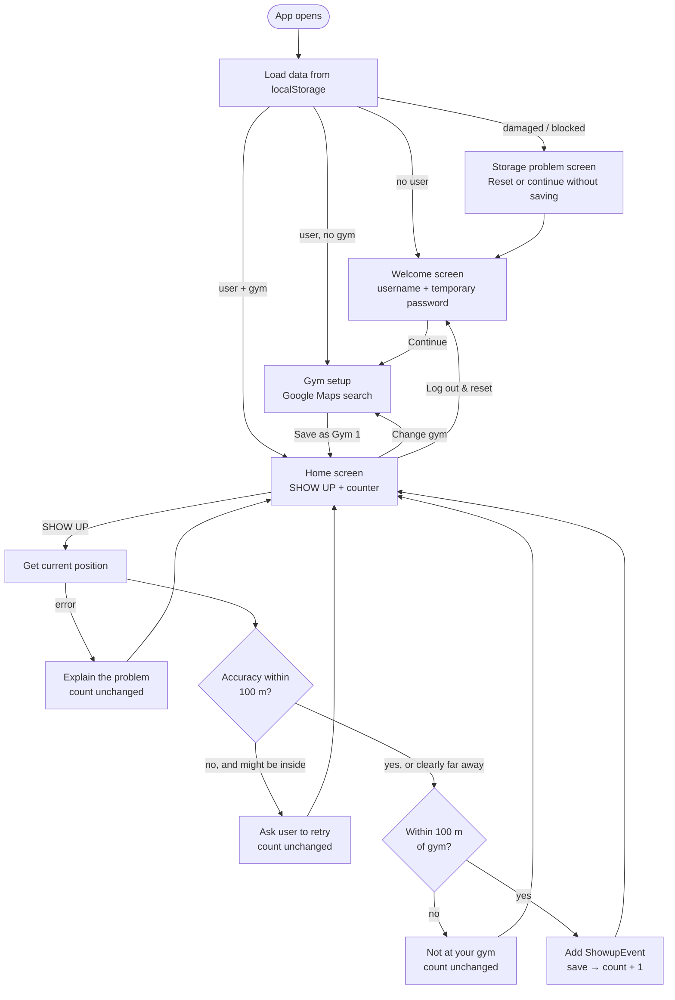

# Architecture

Showup v0.1.0 is a **client-side single-page app**. There is no server. Everything runs in the browser, talks directly to Google Maps for gym search, and saves to `localStorage`.

## The big picture

The code is split into layers. Each layer only talks to the one below it.

```
┌──────────────────────────────────────────────┐
│  Screens & components   (src/features, src/components)
│  Show things; call callbacks when clicked.   │
├──────────────────────────────────────────────┤
│  App + useShowup hook   (src/app, src/hooks) │
│  Owns the app state; decides which screen.   │
├──────────────────────────────────────────────┤
│  Services               (src/services)       │
│  Rules, storage, geolocation, Google Maps.   │
├──────────────────────────────────────────────┤
│  Utils, config, types   (src/utils, src/config, src/types)
└──────────────────────────────────────────────┘
```

The rules that decide whether a Showup counts (`attendanceService.ts`) contain no React code. That makes them easy to test and easy to move to a server later.

## Main user flow



## Folders

| Folder | Purpose |
|---|---|
| `src/app/` | `App.tsx` (chooses the screen), `theme.ts` (MUI dark theme), and the storage problem screen. |
| `src/features/` | One folder per feature, each holding its screen(s): `authentication/`, `gym/`, `attendance/`. |
| `src/components/` | Small reusable UI pieces with no business logic: the button, counter, gym card, feedback message and page layout. |
| `src/hooks/` | `useShowup.ts`: the app's state and actions, shared by all screens. |
| `src/services/` | Code that talks to the outside world (localStorage, Geolocation, Google Maps) and the attendance rules. |
| `src/utils/` | Pure helper functions: distance maths and ID generation. |
| `src/config/` | Settings (`constants.ts`) and user-facing feedback text (`messages.ts`). |
| `src/types/` | TypeScript shapes for users, gyms, events and outcomes. |
| `src/test/` | Shared test data (fixtures). Test files themselves sit next to the code they test (`*.test.ts`). |
| `docs/` | This documentation. |

## How components communicate

Data flows **down** as props, and events flow **up** as callbacks:

1. `App.tsx` calls `useShowup()` once. That gives it the current `user`, `gym`, `showupCount`, `isVerifying`, and the actions `createUser`, `saveGym`, `showUp`, `resetDemoData`.
2. `App` picks a screen and passes it only what that screen needs. For example, `HomeScreen` gets `gym`, `showupCount` and `onShowUp`.
3. Screens pass smaller pieces down to components (`ShowUpButton`, `ShowUpCounter`, `GymSummary`).
4. When something happens (a button press), the component calls the callback it was given, and the change travels back up to `useShowup`.
5. `useShowup` updates its state and saves it. React re-renders, and the new values flow down again.

There is no global store, context or router. With three screens, props and an `if` chain in `App.tsx` are the simplest option.

The only UI state that lives *inside* screens is local and temporary: form inputs, the search text, the selected place, and whether a dialog is open.

## The temporary user

`TemporaryUserScreen` collects a username and password, but only passes the **username** up. `useShowup.createUser` creates:

```ts
{ id: '<random UUID>', username: 'alex', createdAt: '2026-10-12T08:00:00.000Z' }
```

The password is checked for being non-empty, then dropped when the screen unmounts. It is never stored, sent or compared. This is a **demo identity**, not authentication: it exists so data already has a `userId` to hang off, which a real account system will need later.

## Selecting and saving a gym

1. `GymSearch` asks `mapsService.loadPlacesLibrary()` to load the Google Maps script (only once per page). It then creates an **autocomplete session token**.
2. As the user types (at least 3 characters, 300 ms after they stop), it calls `searchPlaces(text, token)`. That uses `AutocompleteSuggestion.fetchAutocompleteSuggestions` from Places API (New).
3. Suggestions appear in an MUI `Autocomplete`. When one is picked, `getPlaceDetails` calls `prediction.toPlace().fetchFields(['id', 'displayName', 'formattedAddress', 'location'])`.
4. The result is a `SelectedPlace`. `GymSetupScreen` shows it in a `GymSummary` card and enables **Save as Gym 1**.
5. `useShowup.saveGym` turns it into a `Gym` with its own Showup `id`, the user's `userId`, the label "Gym 1", and a `createdAt` timestamp. It replaces any previous gym for that user.

The gym gets its **own** ID, separate from Google's `googlePlaceId`, so events never depend on Google's identifiers.

## How geolocation verification works

When SHOW UP is pressed:

1. `useShowup.showUp` returns immediately if a check is already running. It uses a ref (`verificationInProgress`), not just state, so even two very fast taps can't start two checks. The button is also disabled while `isVerifying` is true.
2. It calls `attendanceService.attemptShowup`, passing `getCurrentPosition` from `geolocationService`.
3. `getCurrentPosition` wraps `navigator.geolocation.getCurrentPosition` in a Promise. It asks for `enableHighAccuracy: true`, a 15 s timeout and no cached position. Browser errors become a `GeolocationError` with a `reason`: `unsupported`, `permission-denied`, `unavailable` or `timeout`.
4. `evaluatePosition` decides the outcome:
   - Calculate the distance to the gym.
   - If the reported accuracy is worse than `MAX_LOCATION_ACCURACY_METRES` (100 m) **and** the user could be inside the geofence → `poor-accuracy` (ask them to retry).
   - Otherwise, distance ≤ `GEOFENCE_RADIUS_METRES` (100 m) → `success`; anything further → `outside-geofence`.
   - "Clearly outside" means *distance − accuracy > radius*: even the most generous reading puts the user outside. That gets "not at your gym" rather than a confusing accuracy message.
5. On `success` only, `recordShowup` adds a `ShowupEvent`, and the new data is saved.
6. `HomeScreen` turns the outcome into text using `getFeedbackForOutcome` (`config/messages.ts`). It shows a snackbar for success and a dialog for anything else.

## How distance is calculated

`utils/distance.ts` uses the **Haversine formula**, which gives the great-circle distance between two latitude/longitude points on a sphere with the Earth's mean radius (6,371 km). At gym-sized distances it is accurate to well under a metre, far more precise than the GPS reading itself.

## Persistence: counter and history

All data is one JSON object in `localStorage` under the key `showup:data:v1`:

```ts
interface ShowupData {
  schemaVersion: 1
  user: TemporaryUser | null
  gyms: Gym[]            // one gym in v0.1.0
  events: ShowupEvent[]  // successful Showups only
}
```

- **The counter is not stored separately.** `countShowups` counts the user's events, so the counter and the history *cannot* disagree. The stored total *is* the history.
- `storageService.loadData` checks the JSON's shape before trusting it. It returns `ok`, `corrupted` (bad JSON, wrong shape or unknown `schemaVersion`) or `unavailable` (storage blocked). The app shows `StorageProblemScreen` for the last two instead of crashing.
- `saveData` returns `false` if writing fails (e.g. storage full). The app then shows a warning banner.
- `storageService.ts` is the **only** file that touches `localStorage`.

The shape mirrors three future database tables (`users`, `gyms`, `showup_events`). Every gym and event carries a `userId`.

## External APIs

| API | Where | Notes |
|---|---|---|
| Google Maps JavaScript API + Places API (New) | `services/mapsService.ts` only | Loaded with `@googlemaps/js-api-loader` (`setOptions` + `importLibrary('places')`). Uses session tokens to group autocomplete calls into one billing session. Key comes from `VITE_GOOGLE_MAPS_API_KEY`. |
| Browser Geolocation | `services/geolocationService.ts` only | Requires HTTPS or localhost. |
| Browser localStorage | `services/storageService.ts` only | Per browser, per site. |

Keeping each external API in one file means it can be replaced, or faked in tests, without touching the UI.
