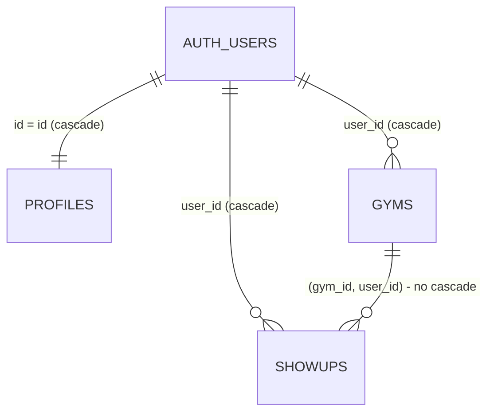

# Database schema

The Showup database lives in Supabase (PostgreSQL). Its structure is defined **only** by the SQL files in [`supabase/migrations/`](../supabase/migrations), which run in file-name order. Never change the database by hand in the dashboard without also writing a migration, or the project and the database will drift apart.

| Migration | Purpose |
|---|---|
| `20261017120000_create_core_tables.sql` | Creates `profiles`, `gyms`, `showups`, their constraints and indexes |
| `20261017120100_provision_profiles.sql` | Trigger that creates a profile for every new Auth user; back-fills existing users |
| `20261017120200_row_level_security.sql` | Turns on Row Level Security, column privileges and all policies |
| `20261018100000_place_search_mode.sql` | Adds `profiles.place_search_mode` and the two functions that control it (admin-only "any place") |

## How the tables relate

`auth.users` is Supabase's own table of signed-in people (created by Google sign-in). It is not edited by this project. Deleting an Auth user removes that person's profile, gyms and Showups, and nobody else's. Deleting a single **gym** that has Showups is refused, so history is never lost.

## `public.profiles`

One row per Auth user.

| Column | Type | Notes |
|---|---|---|
| `id` | uuid, primary key | Same value as `auth.users.id`; `ON DELETE CASCADE` |
| `first_name` | text, null | Trimmed, non-blank, max 100 characters. Pre-filled from Google when available |
| `last_name` | text, null | Same rules |
| `date_of_birth` | date, null | Not before 1900-01-01 |
| `is_admin` | boolean, **not null**, default `false` | Not writable by app users (see below) |
| `place_search_mode` | text, **not null**, default `'fitness_only'` | `'fitness_only'` or `'any_place'` (check constraint). Readable by the user, **not writable** by app users; changed only through `set_place_search_mode()` |
| `created_at` | timestamptz, default `now()` | |
| `updated_at` | timestamptz, default `now()` | Refreshed automatically by a trigger on every update |

## `public.gyms`

A user's gym choices over time. Changing gym keeps the old row (inactive) and adds a new one.

| Column | Type | Notes |
|---|---|---|
| `id` | uuid, primary key | `gen_random_uuid()` |
| `user_id` | uuid, not null | Default `auth.uid()`; references `auth.users`; `ON DELETE CASCADE` |
| `name` | text, not null | Non-blank |
| `google_place_id` | text, null | Null allows manually entered places later |
| `address` | text, null | |
| `latitude` | double precision, not null | Between -90 and 90 |
| `longitude` | double precision, not null | Between -180 and 180 |
| `is_active` | boolean, not null, default `true` | |
| `created_at`, `updated_at` | timestamptz | `updated_at` maintained by trigger |

**Indexes and constraints**
- `gyms_one_active_per_user_idx`: a *partial unique index* on `(user_id) WHERE is_active`. A user may have many gyms but only one active at a time.
- `gyms_user_id_created_at_idx` on `(user_id, created_at DESC)`: listing a user's gyms.
- `gyms_id_user_id_key`: `UNIQUE (id, user_id)`, so Showups can reference a gym **together with its owner**.

## `public.showups`

One row per verified visit. Append-only for app users.

| Column | Type | Notes |
|---|---|---|
| `id` | uuid, primary key | `gen_random_uuid()` |
| `user_id` | uuid, not null | Default `auth.uid()`; references `auth.users`; `ON DELETE CASCADE` |
| `gym_id` | uuid, not null | With `user_id`, references `gyms (id, user_id)`; **no cascade** |
| `occurred_at` | timestamptz, default `now()` | Set by the server |
| `distance_meters` | integer, null | Not negative |
| `location_accuracy_meters` | integer, null | Not negative |
| `verification_method` | text, not null, default `'gps'` | Set by the server for now |
| `created_at` | timestamptz, default `now()` | |

**Indexes and constraints**
- `showups_user_id_occurred_at_idx` on `(user_id, occurred_at DESC)`: "my Showups, newest first" and date ranges.
- `showups_occurred_at_idx` on `(occurred_at)`: reports across users (later admin features).
- `showups_gym_id_user_id_idx` on `(gym_id, user_id)`: supports the foreign key and "Showups at this gym".
- `showups_gym_belongs_to_user`: the composite foreign key `(gym_id, user_id) → gyms (id, user_id)`. Even code that bypasses Row Level Security (the service role, the SQL Editor) cannot attach a Showup to someone else's gym. It is `DEFERRABLE INITIALLY DEFERRED` so that deleting a whole Auth user can remove their gyms and Showups together.

## Security model

Two layers work together. **Both are required.**

1. **Privileges (`GRANT` / `REVOKE`)** decide which tables and *columns* a role can touch. Row Level Security cannot limit columns, so this is what protects `is_admin`.
2. **Row Level Security (RLS)** decides which *rows* each signed-in user can see or change. It is enabled on all three tables, so a table with no matching policy denies access.

The browser connects as `anon` (signed out) or `authenticated` (signed in). The `service_role` key and the SQL Editor bypass RLS; they must never be used in frontend code.

### What `authenticated` users can do

| Table | SELECT | INSERT | UPDATE | DELETE |
|---|---|---|---|---|
| `profiles` | own row | no (a trigger creates it) | own row, **only** `first_name`, `last_name`, `date_of_birth` | no |
| `gyms` | own rows | own rows; columns `user_id, name, google_place_id, address, latitude, longitude` | own rows, **only** `is_active` | no |
| `showups` | own rows | own rows, at one of their own **active** gyms; columns `user_id, gym_id, distance_meters, location_accuracy_meters` | no | no |

Signed-out (`anon`) visitors have **no** access to any table.

### Policies

| Table | Policy | Applies to | Rule |
|---|---|---|---|
| `profiles` | `profiles: read own` | SELECT | `id = auth.uid()` |
| `profiles` | `profiles: update own` | UPDATE | `id = auth.uid()` (before and after) |
| `gyms` | `gyms: read own` | SELECT | `user_id = auth.uid()` |
| `gyms` | `gyms: insert own` | INSERT | `user_id = auth.uid()` |
| `gyms` | `gyms: update own` | UPDATE | `user_id = auth.uid()` (before and after) |
| `showups` | `showups: read own` | SELECT | `user_id = auth.uid()` |
| `showups` | `showups: insert own at own active gym` | INSERT | `user_id = auth.uid()` **and** an active gym with that ID owned by the same user exists |

(`auth.uid()` is written as `(select auth.uid())` in the SQL, which lets Postgres evaluate it once per query instead of once per row.)

### Why users cannot become administrators

- `is_admin` is not in the list of columns `authenticated` may `UPDATE`, so any statement that names it fails with *permission denied*. This also blocks "update every column" tricks.
- Users cannot `INSERT` into `profiles` at all, so they cannot create an admin row either.
- The signup trigger ignores user metadata completely. `is_admin` always takes its default, `false`, whatever Google (or a crafted sign-up) supplies.
- The only way to make someone an admin is the SQL Editor or the service role: `update public.profiles set is_admin = true where id = '<user id>';`. See [SETUP_SUPABASE.md](SETUP_SUPABASE.md).

## Gym search mode (administrator-only "any place")

`profiles.place_search_mode` decides which places the gym search offers. It is `fitness_only` for everyone by default.

| Function | Who can call it | What it does |
|---|---|---|
| `set_place_search_mode(new_mode text)` | signed-in users (not `anon`) | Sets the **caller's own** mode. Anyone may choose `fitness_only`; `any_place` is refused with *"Only administrators can search any place"* unless the caller's profile has `is_admin = true`. Rejects any other value. |
| `effective_place_search_mode()` | signed-in users | Returns the mode that really applies: `any_place` only if the caller is **currently** an administrator and has chosen it, otherwise `fitness_only`. |

Why it is safe:
- App users have **no** `UPDATE` privilege on the column (the grant is still only `first_name, last_name, date_of_birth`), so they cannot write it directly, alone or together with other columns.
- The function is `SECURITY DEFINER` (it runs with the owner's rights because users cannot write the column), so it does its own checks, takes the user from `auth.uid()` (the verified sign-in), never from an argument, and sets `search_path` to empty.
- Removing someone's admin rights in the SQL Editor immediately restricts them again, because `effective_place_search_mode()` and the app both require `is_admin` as well as the stored value.
- `is_admin` itself is unchanged: still not writable by app users.

**Limitation:** this controls *who may widen the search*. It does not (yet) validate *which place* a gym is, because gyms are still saved in the browser (localStorage), not in the `gyms` table. The fitness filter on the place itself therefore runs in the app. When gyms move to the database, the same rule should be enforced there (for example by an Edge Function that checks the place type with Google before inserting).

## Profile creation trigger

`on_auth_user_created` runs `public.handle_new_user()` after each insert into `auth.users`:
- It inserts one `profiles` row in the same transaction, so a signed-in user always has a profile.
- It copies only Google's `given_name` / `family_name`, trimmed and cut to 100 characters so it can never fail a constraint and block sign-in.
- It makes no network calls and reads nothing else from metadata.
- It is `SECURITY DEFINER` with `search_path` set to empty, and `EXECUTE` is revoked from app roles so it can only run as a trigger.
- A profile that already exists is left alone (`ON CONFLICT DO NOTHING`).

## Important limitation: GPS data is not fraud-proof

The database confirms **who** recorded a Showup and **at which of their own gyms**. It cannot confirm **where the person really was**. The distance and accuracy values arrive from the user's browser, so a determined user can send false values or fake their GPS location. Users also choose when to insert (`occurred_at` is server-set, so a Showup cannot be backdated, but nothing yet stops several per day).

Real verification needs a server-side check, for example a Supabase Edge Function that receives the coordinates, calculates the distance itself, and is the only thing allowed to insert Showups. That is a later step. Today the Show Up flow still saves to the browser (localStorage), not to this table; the `showups` table is prepared for the migration.

## Changing the schema later

1. Add a **new** migration file with a later timestamp; never edit one that has already been applied.
2. Apply it (see [SETUP_SUPABASE.md](SETUP_SUPABASE.md)).
3. Run `npm test` — the tests in `supabase/tests/` apply every migration to a throw-away Postgres and check the security rules.
4. Update this document and the changelog.
